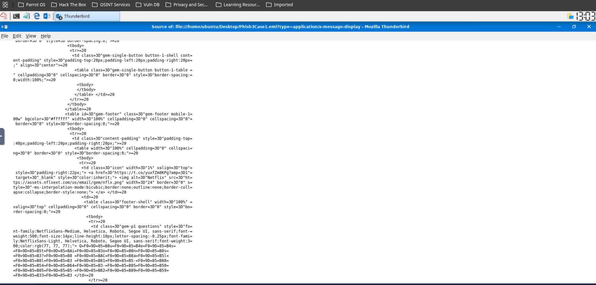
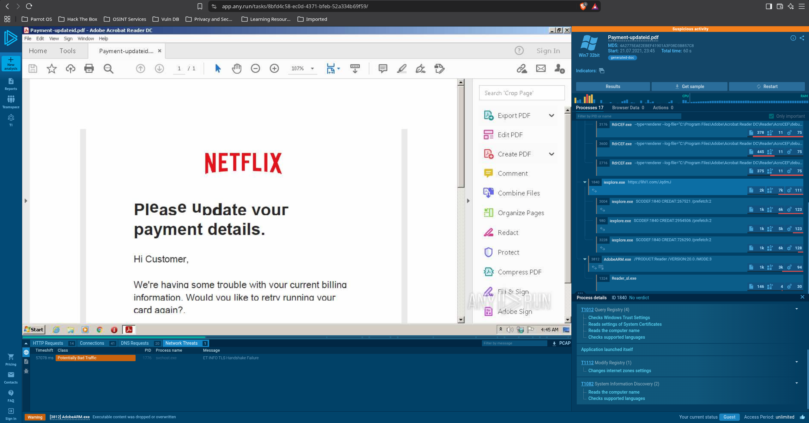
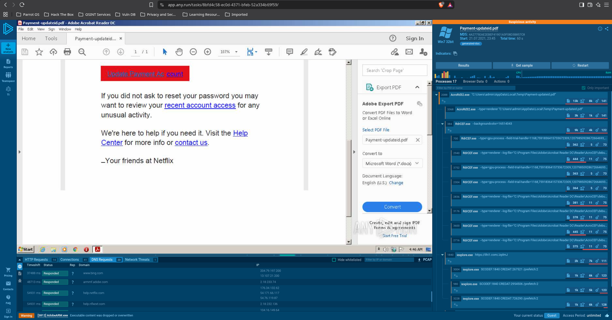
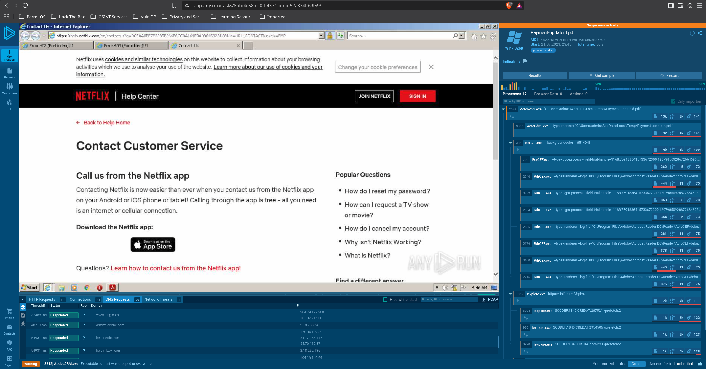

## Phishing Email Analysis - SOC LEVEL 1 LAB

## Objective/Scenerio
"In this scenerio, I acted as a Level 1 SOC Analyst. As the first line of defense, my role was to identify
phisihing and spam emails reported by end users. The objective was to carefully review and analyze multiple suspicious emails that have been escalated by coworkers."

Goals of the Investigation:

1)Extract key indicators (IOCs) from each email.
2)Identify any signs of malicious activity.
## Email 1
.png)

Email :"Your Netflix Account is on hold"

Header Analysis:

Sender: N e t f I i x <JGQ47wazXe1xYVBrkeDg-JOg7ODDQwWdR@JOg7ODDQwWdR-yVkCaBkTNp[.]gogolecloud[.]com> (Notice brand name that was spoofed NETFLIX)

.png)

Intended receiver: redacted@yahoo[.]com

Received from IP:10[.]197[.]37[.]234

Return-Path / Reply-To: etekno[.]xyz

DKIM : unkown
SPF: none 
Sender Domain: etekno[.]xyz
.png)

Email Body Analysis:
Call to Action: The email contains a button labeled "Update account Now.
This uses urgency to trick the user into clicking.
.png)

Hidden Link (URL SHORTENER): When viewing the email in thunderbird, hovering over the button reveals a shortened URL instead of actual destination.Phishing use URL shorteners to hide malicious domain and bypass security filters.

Extracted URL: hxxps://t[.]co/yuxfZm8KPg?amp=1

---

## Email 2: "Netflix Payment Update" (PDF Attachment Analysis) 

### Objective 
Investigate a suspicious attachment ('Payment-update.pdf') using the ANY.RUN sandbox environment to observe its execution behavior, network activity, and extract Indicators of Compromise (IOCs).

### Sandbox Analysis (ANY.RUN)

**1 File Execution & Behavior:**
Attachment Name: 'Payment-Update.pdf'
When executed in the sandbox, the PDF opened a web browser process "firefox.exe".
Instead of displaying a document, the PDF silently redirected browser to a fake Netflix "Account on Hold" login page.
**ANY.RUN Classification:**The sandbox classified this as a "Suspicious activity" and specifically refer to it as "Potentially Bad Traffic".

**2 Network Activity & Payload Delivery:**
The PDF document contained an embedded URL that forced the browser to navigate to: 'hxxps://lihi1[.]com/JgdmJ'.
This URL resoled to the IP address: 35[.]244[.]149[.]249
The page was designed to harvest user credentials by tricking the victim into entering their Netflix password.

## Indicators of Compromise (IOCs)**
* File Name: 'Payment-Update.PDF'
* DM5 Hash: '4a2775eae2ebef41901a3f08d3b857c8'
* Malicious URL: 'hxxps://lihi1[.]com/JgdmJ'
* IP ADDRESS: '35[.]244[.]149[.]249'

### CONCLUSION
The attachment is a malicious PDF. It uses an embedded URL to redirect the victim to a credential harvesting site. The URL ('lihi1.com') is a know shortener, which attackers use to hide their final destination and bypass email filters.
